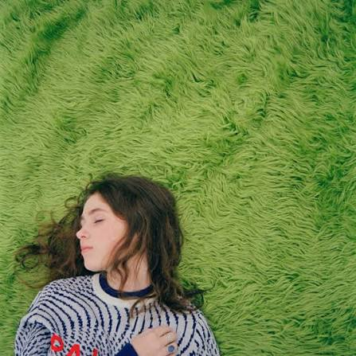

# Erlang Andriyanputra

<table>
  <tr>
    <td width="48%" valign="top">
      
      

        <strong>⚡ KAMEN RIDER KUUGA</strong>
         
        THE ULTIMATE FORM
      

    </td>
    <td width="52%" valign="top">

### 👨‍💻 About Me

**Erlang Andriyanputra**

Information Systems Student  
Developer · Tech Enthusiast

I'm a student at Politeknik Negeri Banjarmasin, interested in web development, software engineering, and exploring new technologies.

- 🎓 Sistem Informasi Kota Cerdas
- 💻 Focused on web development
- ⚡ Always learning and building

---

### 🎧 Currently Listening

**Hello?**  
Clairo, Rejjie Snow

♫ On repeat

 

   
  </tr>
</table>

---

## 🧰 Tech Stack

**Languages**

**Frontend**

**Backend & Database**

**Tools & Environment**

---

## 🎓 Education

| Period | Institution | Program |
|:---|:---|:---|
| 2013–2019 | SDN Sungai Jingah 6 Banjarmasin | Elementary School |
| 2019–2022 | SMPN 27 Banjarmasin | Junior High School |
| 2022–2025 | SMKN 2 Banjarmasin | Vocational High School |
| 2025–Present | Politeknik Negeri Banjarmasin | Sistem Informasi Kota Cerdas |

---

  <i>“For the smiles of people, I will fight.”</i>
   
  <strong>Kamen Rider Kuuga ⚡</strong>

